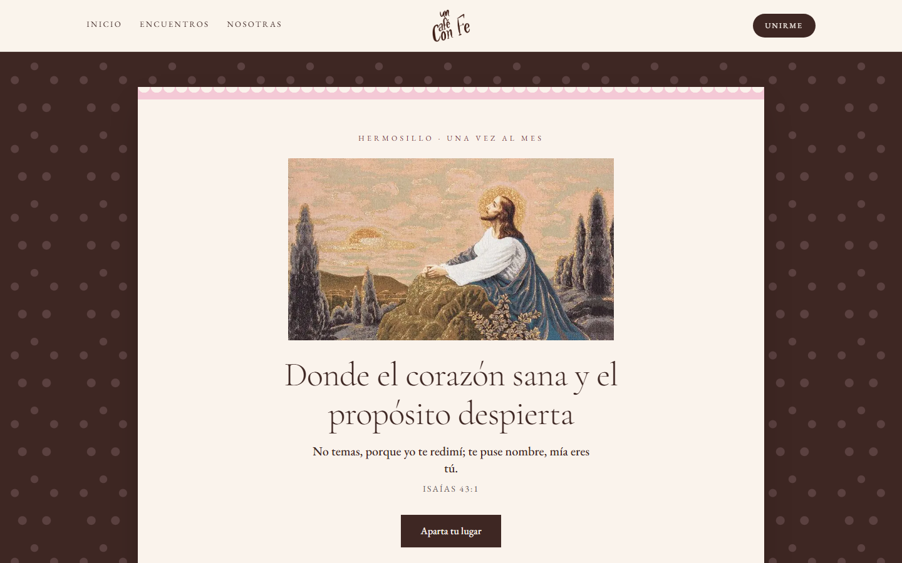

# Un Café con Fe

Sitio web de **Un Café con Fe**, una comunidad de mujeres en Hermosillo, Sonora, que se reúne una vez al mes en un ambiente tipo café. El sitio da a conocer los encuentros, permite apartar lugar, vende artículos de la comunidad y tiene un panel para que las organizadoras actualicen todo sin tocar código.

**Sitio en vivo:** [cafeconfe.vercel.app](https://cafeconfe.vercel.app)



## Funcionalidades

**Sitio público**
- **Encuentros:** listado y página de cada evento con formulario de registro (nombre y WhatsApp) y control de asistencia.
- **Tienda:** catálogo de productos con página de detalle.
- **Oración:** formulario para enviar peticiones de oración.
- **Testimonios:** las asistentes pueden compartir su testimonio; se publica solo tras aprobarse.
- **Nosotras** y galería de la comunidad, con enlace a la Comunidad de WhatsApp.
- Animaciones con Motion, diseño adaptable a celular, SEO (metadatos, Open Graph, `sitemap.xml` y `robots.txt`) y estados de carga y error.

**Panel de administración (`/admin`)**
- Inicio de sesión con Supabase Auth.
- Alta y edición de encuentros, productos, preguntas frecuentes y testimonios.
- Consulta de registros por evento con asistencia, y de peticiones de oración.
- Carga de fotos a Supabase Storage, con conversión automática de fotos HEIC de iPhone.
- Configuración del sitio: textos, logo y enlaces editables.

## Tecnologías

| Capa | Tecnología |
|---|---|
| Framework | Next.js 16 (App Router), React 19 |
| Lenguaje | TypeScript |
| Estilos | Tailwind CSS 4, sistema de diseño propio con tokens |
| Animación | Motion |
| Datos y autenticación | Supabase (PostgreSQL, Auth y Storage) |
| Calidad | ESLint, Prettier, verificación de tipos |
| Despliegue | Vercel |

## Estructura

```
src/app/(public)/   páginas públicas: inicio, eventos, tienda, oración, nosotras
src/app/admin/      panel de administración protegido
src/components/     secciones, componentes de UI, animaciones y formularios del panel
src/lib/            acceso a datos de Supabase y utilidades
src/styles/tokens/  tokens del sistema de diseño
supabase/           scripts SQL del esquema y migraciones
docs/               análisis de diseño y capturas
```

## Correr en local

```bash
npm install
cp .env.example .env.local   # llena las variables de Supabase y la URL del sitio
npm run dev                  # http://localhost:3000
```

Para la base de datos, ejecuta en el editor SQL de Supabase `supabase/00_setup_completo.sql` y después los scripts numerados en orden.

Otros comandos: `npm run build`, `npm run lint`, `npm run typecheck` y `npm run format`.

## Autoría

Diseño y desarrollo: **Nicole Gracia Mendoza** · [GitHub](https://github.com/NICOLE291004)
